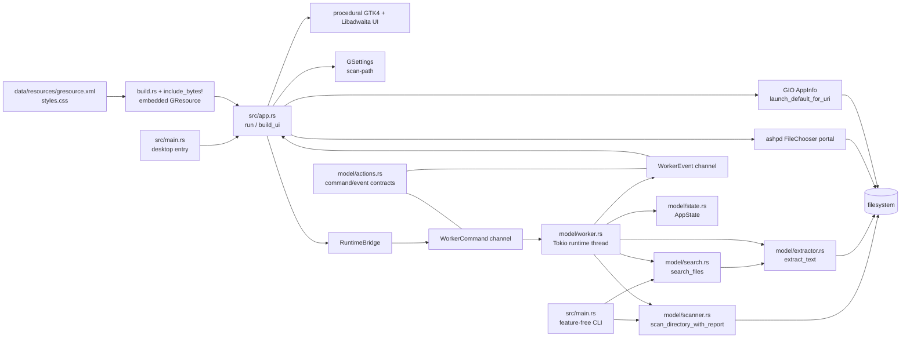

# Component architecture

The following diagram describes only the currently runnable entry points and
modules. The old Blueprint and disabled widget modules are not part of the
runtime path.

## Boundaries

`model/*` is feature-free and owns filesystem traversal, text extraction,
search matching, state types, and asynchronous worker contracts. `app.rs` is
the Linux desktop adapter: it keeps UI mutation on the GLib main loop and
bridges to the Tokio worker through `RuntimeBridge`. GSettings stores only the
last selected `scan-path`; scan indexes and search results remain in memory.

`build.rs` invokes GLib resource/schema tools only for the Linux desktop
feature. The generated resource is a build input to `include_bytes!`, not a
runtime file lookup.

## External integrations

- The portal supplies a user-approved local folder URI.
- GIO opens selected files using the platform default application.
- Tesseract/Leptonica are used only by the OCR-enabled Linux build.
- Flatpak supplies the sandbox, portal access, native libraries, and tessdata.

## Entry-point behavior

`build_ui()` creates the left file list, folder chooser action, search entry,
status indicators, results list, and pagination button. `load_settings()` is
optional when the schema is unavailable during development; the configured
path is read when the schema is found. `choose_folder()` persists a selected
path and sends `WorkerCommand::Scan`, while `open_file()` delegates launching
to GIO.
