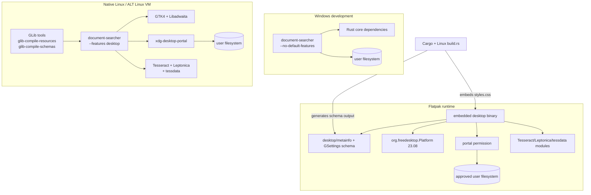

# Deployment architecture

Windows validates only the feature-free scanner, extractor (without OCR),
search, worker, and CLI. Native Linux requires the desktop dependencies and
GLib tools. The ALT Linux VM is the target environment for GUI, portal,
GSettings, OCR, and Flatpak checks.

The Flatpak manifest is `src/flatpak/org.gtk.DocumentSearcher.json`. Its cargo
source list is expected to be generated on Linux with
`cargo flatpak-generator --output flatpak/generated-sources.json` after the
lockfile is stable. The generated GResource is embedded in the binary, so no
standalone resource file is deployed.

The manifest currently sets `DOCUMENT_SEARCHER_OCR_LANG=eng` and installs
English tessdata, while the extractor default is historically `eng+rus`.
This mismatch is intentionally documented rather than changed without Linux
validation.

## Deployment checks

In the ALT Linux VM, run native desktop checks first, then generate cargo
sources and run `flatpak-builder`/`flatpak run org.gtk.DocumentSearcher`.
Check the schema lookup, CSS resource lookup, portal folder chooser, file
opening, and OCR separately; a Windows core pass cannot substitute for any of
these checks.
