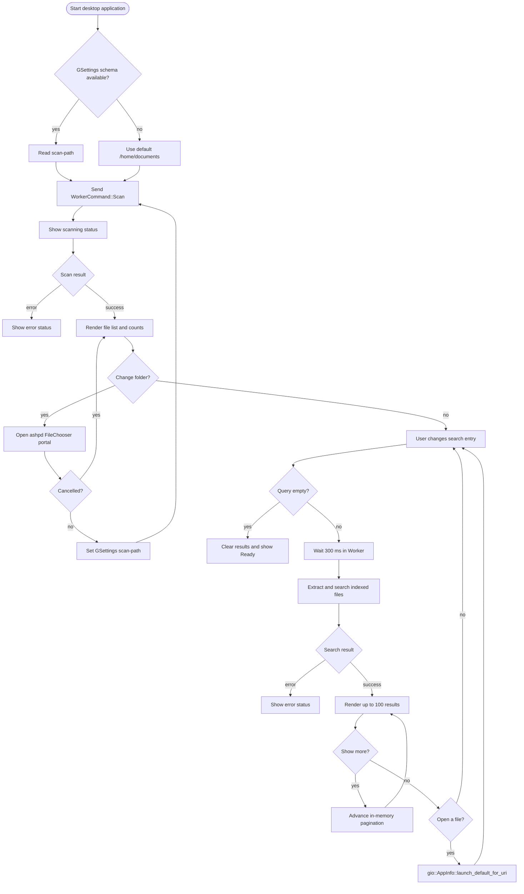

# User flow

The initial path is `/home/documents` unless a valid `scan-path` setting is
restored. Folder selection is mediated by the portal; cancellation keeps the
previous path and index. A successful selection persists the path and starts a
new scan. Search results, pagination offset, and the indexed file list are
memory-only.

Errors from scanning, extraction, the portal, or GIO are shown in the status
area. A new query cancels the prior debounced/active search; an empty query
clears results without starting extraction.
