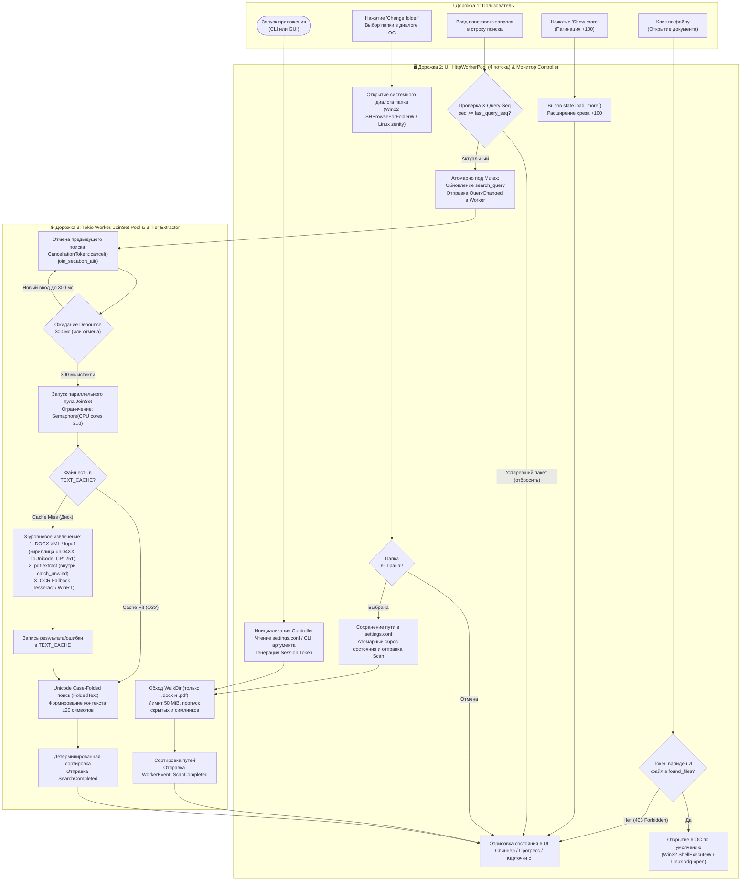
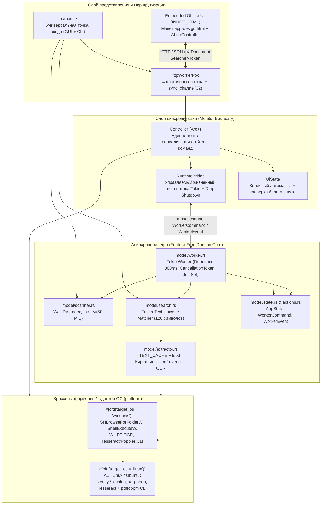
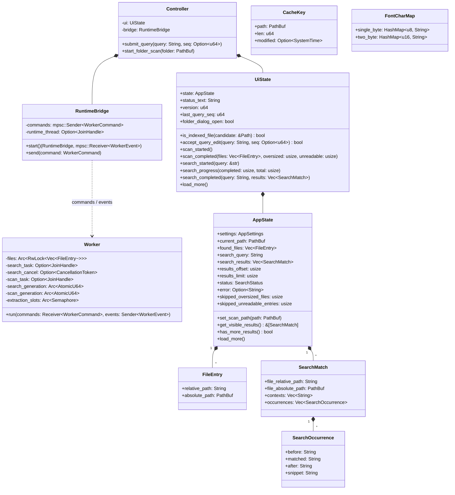
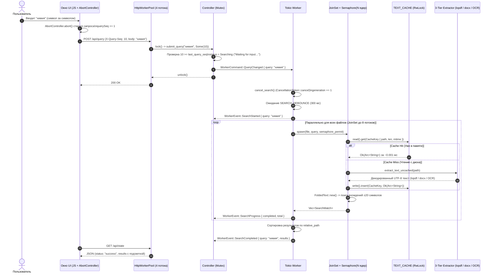
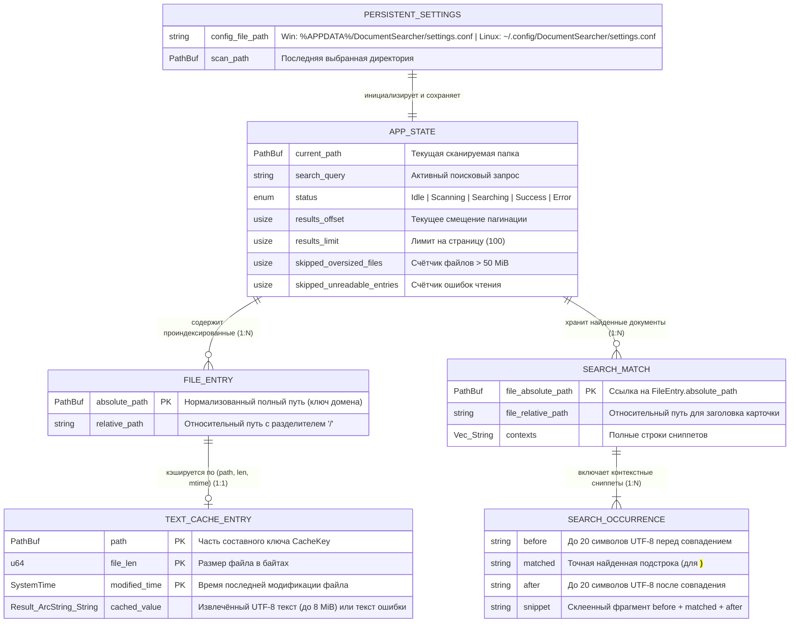

# Единая техническая спецификация и архитектура системы (SRS & System Design)

**Проект:** Document Searcher  
**Версия архитектуры:** 2.0 (Unified Cross-Platform Edition)  
**Целевые платформы:** Windows 10/11, ALT Linux (p10/p11), Ubuntu Linux (22.04 / 24.04 LTS)  
**Язык и тулчейн:** Rust Stable (`1.78.0`, Edition 2021)  

---

## 1. Назначение и концепция системы

**Document Searcher** — это высокопроизводительное настольное и консольное (CLI + GUI) приложение для глубокого контекстного поиска подстрок внутри локальных документов форматов **`.docx`** и **`.pdf`** (с возможностью расширения списка форматов через параметры запуска).

Приложение спроектировано по принципу **Zero-C-Build-Dependencies**: оно не требует установки тяжёлых компиляторов C/C++ или `*-devel` пакетов графических тулкитов при сборке из исходного кода и компилируется единой командой `cargo build --release` на Windows, ALT Linux и Ubuntu.

---

## 2. Функциональные требования (FR)

### FR-1: Управление директориями и запуск
* **FR-1.1:** Приложение поддерживает как графический режим (GUI), так и консольный режим (`scan`, `search`) в едином исполняемом файле `document-searcher`.
* **FR-1.2:** При запуске без аргументов приоритетно открывается последняя сохранённая папка из конфигурационного файла (`settings.conf`) либо текущая рабочая директория (`current_dir`).
* **FR-1.3:** При передаче пути к папке через аргумент командной строки (`document-searcher <путь>` или `document-searcher gui <путь>`) приложение немедленно открывает и индексирует указанную директорию.
* **FR-1.4:** Пользователь может в любой момент сменить папку через нативный системный диалог выбора директории (Win32 `SHBrowseForFolderW` на Windows; `zenity` / `kdialog` на ALT Linux и Ubuntu). Отмена диалога сохраняет текущий индекс и результаты поиска неизменными.

### FR-2: Индексация файлов (`scanner.rs`)
* **FR-2.1:** Рекурсивный обход дерева каталогов выполняется через `WalkDir` без перехода по символическим ссылкам (`follow_links(false)`) во избежание циклических петель.
* **FR-2.2:** Скрытые файлы и директории (начинающиеся с `.`) автоматически игнорируются на любом уровне вложенности.
* **FR-2.3:** По умолчанию индексируются **только файлы `.docx` и `.pdf`** (регистронезависимо). Пользователь может переопределить список расширений через флаг `--ext <список>` или переменную окружения `DOCUMENT_SEARCHER_EXTENSIONS`.
* **FR-2.4:** Файлы размером более **50 MiB** (`52 428 800` байт) пропускаются с увеличением счётчика `oversized_files`. Нечитаемые записи фиксируются в счётчике `unreadable_entries`.
* **FR-2.5:** Все относительные пути нормализуются к единому разделителю `/` и сортируются лексикографически. Расширенные пути Windows (`\\?\C:\...` и `\\?\UNC\server\share\...`) нормализуются функцией `normalize_platform_path`.

### FR-3: Многоуровневое извлечение текста и кэширование (`extractor.rs`)
* **FR-3.1 (In-Memory Кэш `TEXT_CACHE`):** Извлечённый текст каждого файла кэшируется в потокобезопасном хранилище `OnceLock<RwLock<HashMap<CacheKey, CacheValue>>>` по составному ключу `(PathBuf, размер_файла, время_модификации)`. Повторные поисковые запросы читают текст из ОЗУ за микросекунды без повторного обращения к диску. Ошибки повреждённых файлов также кэшируются, чтобы не парсить сбойные файлы повторно.
* **FR-3.2 (Извлечение `.docx`):** Выполняется путём потокового чтения `word/document.xml` из ZIP-архива через `quick-xml` с сохранением абзацев (`w:p`), переносов (`w:br`) и табуляций (`w:tab`).
* **FR-3.3 (Трёхуровневый конвейер `.pdf`):**
  1. **Уровень 1 — Постраничный декодер `lopdf` с поддержкой кириллицы:** Разбирает PDF постранично, декодируя таблицы шрифтов `/Encoding -> /Differences` (включая глифы `/uni0410`..`/uni044F`, `/afii10017`..`/afii10097`, `.cap`-глифы), потоки `/ToUnicode` (`beginbfchar` и `beginbfrange`), `UTF-16BE` и однобайтовую кириллицу `CP1251`.
  2. **Уровень 2 — Изолированный `pdf-extract`:** Запускается внутри `std::panic::catch_unwind` (защита от паник на сложных цветовых функциях PDF, таких как *Function Type 4*). Выбирается результат с наибольшим числом буквенных символов.
  3. **Уровень 3 — OCR для отсканированных PDF без текстового слоя:** Если текстовый слой пуст, вызывается рендеринг страниц через `pdftoppm` + `tesseract` (`eng+rus` с автоматическим откатом на `eng`), а на Windows при отсутствии внешних утилит — встроенный системный движок **Windows WinRT (`Windows.Data.Pdf` + `Windows.Media.Ocr`)**.

### FR-4: Регистронезависимый поиск и многопоточность (`search.rs`, `worker.rs`)
* **FR-4.1 (Unicode Case-Folding):** Поиск сопоставляет подстроку без учёта регистра через структуру `FoldedText`, сохраняющую точные байтовые границы (`source_spans`) каждого символа исходного текста UTF-8.
* **FR-4.2 (Контекстные сниппеты):** Для каждого вхождения формируется структура `SearchOccurrence` с контекстом **до 20 символов до совпадения** (`before`), **точной найденной подстрокой** (`matched`) и **до 20 символов после совпадения** (`after`).
* **FR-4.3 (Debounce и отмена):** Поиск запускается с задержкой **300 мс** после последнего ввода символа. Новый ввод немедленно отменяет текущий поиск через `CancellationToken` и `join_set.abort_all()`.
* **FR-4.4 (Параллельный пул `JoinSet` + `Semaphore`):** Извлечение и поиск выполняются параллельно на всех доступных ядрах CPU (`available_parallelism()`, от 2 до 8 потоков одновременно) с детерминированной итоговой сортировкой результатов.

### FR-5: Графический интерфейс, пагинация и безопасность (`app.rs` / `app_win.rs`)
* **FR-5.1 (Разделение экрана 50/50):** Левая панель отображает текущий путь, количество найденных файлов, прокручиваемый список файлов и кнопку смены папки. Правая панель содержит поле поиска, индикатор состояния (спиннер / зелёная галочка / ошибка) и карточки результатов с жёлтым выделением совпадений (`<mark>`).
* **FR-5.2 (Кумулятивная пагинация):** Результаты выдаются порциями по **100 документов**. Кнопка `"Show more"` догружает следующие 100 результатов в список без удаления предыдущих.
* **FR-5.3 (Безопасное открытие файлов):** Клик по файлу открывает его в программе ОС по умолчанию (Win32 `ShellExecuteW` на Windows; `xdg-open` на ALT Linux / Ubuntu) только после проверки принадлежности пути к белому списку текущего индекса (`is_indexed_file`) и проверки сессионного CSRF-токена (`X-Document-Searcher-Token`).

---

## 3. Нефункциональные требования (NFR)

* **NFR-1 (Отзывчивость UI):** Поток управления состоянием UI никогда не блокируется файловым вводом-выводом или парсингом PDF.
* **NFR-2 (Отказоустойчивость):** Паника парсера, повреждённый ZIP/PDF или ошибка чтения одного файла перехватываются на уровне файла (`catch_unwind` + `Result`), логируются через `tracing::warn!` и никогда не прерывают пакетный поиск по остальным файлам.
* **NFR-3 (Автономность):** Вся вёрстка, стили и скрипты встроены в исполняемый файл (`INDEX_HTML`) и работают на 100% офлайн без внешних CDN.

---

## 4. BPMN 2.0: Сквозной бизнес-процесс работы системы

Диаграмма ниже описывает полный цикл работы приложения в разрезе трёх дорожек (Swimlanes): **Пользователь**, **UI & Synchronized Controller** и **Async Tokio Worker & Extraction Pool**.



---

## 5. UML-диаграммы архитектуры

### 5.1. UML Component Diagram (Диаграмма компонентов и платформенных адаптеров)



---

### 5.2. UML Class Diagram (Диаграмма классов и структур данных Rust)



---

### 5.3. UML Sequence Diagram (Многопоточный поиск, отмена и работа кэша)



---

### 5.4. UML State Machine Diagram (Конечный автомат состояний `SearchStatus`)

```mermaid
stateDiagram-v2
    [*] --> Idle: Инициализация AppState

    Idle --> Scanning: WorkerCommand::Scan / ScanStarted
    Scanning --> Idle: ScanCompleted (N файлов проиндексировано)
    Scanning --> Error: ScanError (Папка недоступна)

    Scanning --> Scanning: QueryChanged(пустой) [Игнорируется, не сбивает Scanning]

    Idle --> Searching: QueryChanged(непустой запрос)
    Success --> Searching: QueryChanged(новый непустой запрос)
    Error --> Searching: QueryChanged(новый непустой запрос)

    Searching --> Searching: SearchStarted / SearchProgress [Если query == current_query]
    Searching --> Idle: QueryChanged(пустой запрос) / SearchCancelled
    Searching --> Success: SearchCompleted [query == current_query]
    Searching --> Error: SearchError [query == current_query]

    Success --> Idle: QueryChanged(пустой запрос)
    Success --> Scanning: Смена папки (Change folder)
    Error --> Scanning: Смена папки (Change folder)
```

---

## 6. ERD: Модель данных, кэша и персистентности (Data & Cache Schema)

Поскольку приложение работает без внешней СУБД, роль схемы данных выполняют персистентная конфигурация на диске, индекс файлов в памяти, потокобезопасный кэш текста `TEXT_CACHE` и структуры результатов поиска.



---

## 7. Спецификация кроссплатформенного слоя (Windows / ALT Linux / Ubuntu)

| Подсистема | Реализация на Windows (`target_os = "windows"`) | Реализация на ALT Linux и Ubuntu (`target_os = "linux"`) |
| :--- | :--- | :--- |
| **Хранение `settings.conf`** | `%APPDATA%\DocumentSearcher\settings.conf` | `$XDG_CONFIG_HOME/DocumentSearcher/settings.conf` (или `~/.config/DocumentSearcher/settings.conf`) |
| **Диалог выбора папки** | Нативный Win32 COM `SHBrowseForFolderW` (`shell32.dll` / `ole32.dll`) | Системный диалог `zenity --file-selection --directory` с автоматическим откатом на `kdialog --getexistingdirectory` |
| **Открытие документа** | Нативный Win32 `ShellExecuteW(..., "open", ...)` | Системный вызов `xdg-open <путь>` (с откатом на `gio open <путь>`) |
| **Запуск графического окна** | `msedge.exe`, `chrome.exe` или `browser.exe` в режиме `--app=http://127.0.0.1:<port>` (откат на браузер по умолчанию) | `chromium`, `chromium-browser`, `google-chrome`, `msedge` в режиме `--app=http://127.0.0.1:<port>` (откат на `xdg-open`) |
| **Подавление шума `stdout`** | Перенаправление `STD_OUTPUT_HANDLE` в системное устройство `NUL` (`CreateFileW`) | Перенаправление файлового дескриптора `stdout` при необходимости; логирование `tracing` в `stderr` |
| **OCR отсканированных PDF** | `pdftoppm.exe` + `tesseract.exe` (с `CREATE_NO_WINDOW`), откат на встроенный **Windows WinRT (`Windows.Data.Pdf` + `Windows.Media.Ocr`)** | Системные пакеты `/usr/bin/pdftoppm` (`poppler-utils`) + `/usr/bin/tesseract` (`tesseract-ocr`) |
